<h1 align="center">¡Hola! Soy Gabriel Iborra</h1>

<p align="center">
  Desarrollador Web en Formación en el CIFP Carlos III (GSDAW) · Técnico en Sistemas en el IES Dos Mares (GMSMR)
</p>

<p align="center">
  <a href="mailto:pdawgabriel@gmail.com"></a>
</p>

<div align="center">
  <picture>
    <source media="(max-width: 767px)" srcset="https://raw.githubusercontent.com/pdawgabriel-hub/pdawgabriel-hub/main/assets/cifras-movil.svg">
    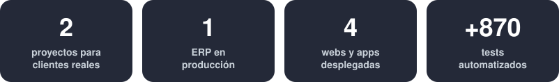
  </picture>
</div>

---

## Proyectos para clientes

<table align="center">
  <tr>
    <td>
      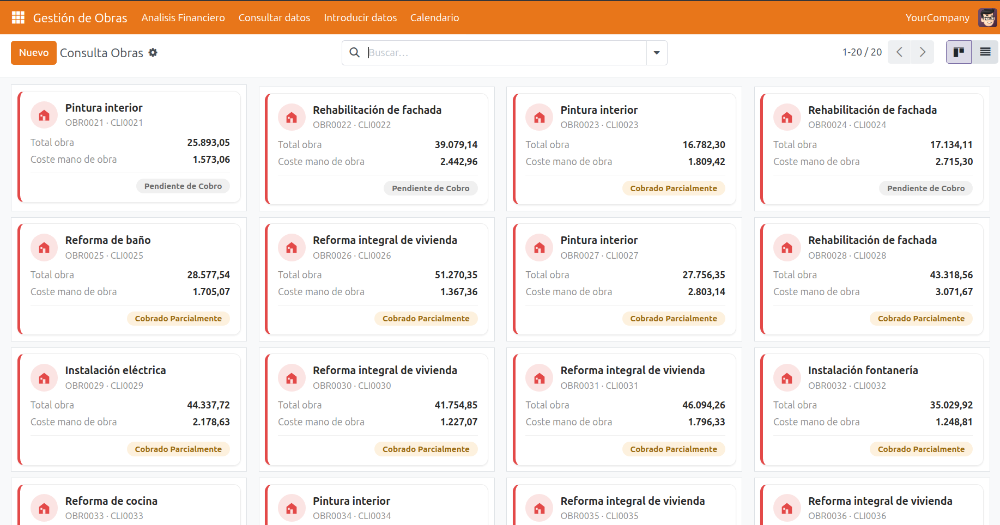
      <h3>ERP a Medida para Construcción y Reformas</h3>
      
      <p>ERP para una empresa real de construcción y reformas que controla cada obra de principio a fin, del presupuesto al beneficio real, con un panel de análisis financiero de toda la cartera de obras.</p>
      <p><sub><b>14 modelos · 41 tablas · 23 tests · Docker + HTTPS en un VPS de la UE</b></sub></p>
      <p>
        
        
        
        
        
      </p>
      
    </td>
  </tr>
  <tr>
    <td>
      <picture>
        <source media="(max-width: 767px)" srcset="https://raw.githubusercontent.com/pdawgabriel-hub/pdawgabriel-hub/main/assets/erp-flujo-movil.svg">
        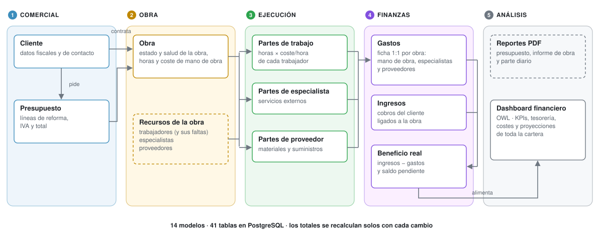
      </picture>
    </td>
  </tr>
</table>

<details>
<summary><b>Ver detalles técnicos</b></summary>

<br>

Un sistema integral diseñado para automatizar la carga administrativa y mitigar pérdidas económicas mediante un control financiero estricto en tiempo real. Cubre todo el ciclo de una obra — cliente → presupuesto (con IVA y líneas de reforma) → obra → ejecución (partes de trabajo, especialistas y proveedores) → cierre financiero (ingresos, gastos, beneficio real y saldo pendiente) — con roles de usuario diferenciados y un panel de Análisis Financiero agregado de toda la cartera de obras. Desarrollado para una empresa real de construcción y reformas y **en producción** desde octubre de 2026, en un VPS en la UE con dominio propio y HTTPS.

*   **ERP a Medida para el Sector de la Construcción y Reformas (Odoo 18)**:
*   **Backend & DB:** Diseño de 14 modelos de negocio en Python sobre PostgreSQL (41 tablas: 35 de datos, incluidos los historiales de observaciones e incidencias y los adjuntos, y 6 tablas puente), con restricciones de negocio (`@api.constrains`), campos calculados que se recalculan en tiempo real y 23 tests automatizados sobre la lógica financiera y la integridad de los datos. Modelos principales: Clientes, Trabajadores, Proveedores, Especialistas, Obras, Presupuestos (+ Líneas de Reforma), Gastos, Ingresos, Partes de Trabajo (+ Líneas), Partes de Especialista, Partes de Proveedor y Faltas de Trabajadores.
*   **Integridad de datos:** Presupuestos e ingresos siempre del cliente de su obra, todo cobro ligado a una obra, obras con cobros protegidas contra el borrado, borrados en cascada a través del ORM (recalculando los acumulados y eliminando también los ficheros adjuntos), ficha financiera 1:1 que nace y desaparece con su obra, y migraciones de datos versionadas para cambios con la base de datos ya en producción.
*   **Frontend Analítico:** Dashboard interactivo desarrollado con el framework **OWL (Odoo Web Library)**, JS y CSS para renderizar KPIs de salud financiera y flujos de caja en vivo. Interfaz adaptada también a móvil.
*   **Infraestructura y Despliegue:** Docker Compose con Odoo, PostgreSQL y Nginx Proxy Manager (HTTPS con Let's Encrypt), volúmenes persistentes con nombre, puertos internos accesibles solo en local, copias de seguridad automáticas de la base de datos y de los adjuntos con restauración verificada, plantillas de configuración y flujo de ramas `develop`/`main`. Los datos de demostración solo se generan en bases de datos de desarrollo, para no trabajar nunca con datos reales de clientes fuera de producción. Desplegado en producción por SSH solo con clave, firewall con únicamente los puertos web abiertos, actualizaciones de seguridad automáticas y *deploy key* de solo lectura, con arranque automático verificado tras reiniciar el servidor.
*   **Documentación:** Informe técnico completo (arquitectura, cada modelo con sus campos, relaciones y métodos, y las reglas de negocio independientes del framework con una guía para reimplementarlo en otro stack: modelo relacional, equivalencias de conceptos de Odoo y escenario de pruebas), esquema SQL contrastado con la base de datos real y diagramas entidad-relación, guía de usuario de 38 páginas (cada pantalla, campo, filtro y agrupación explicados sin tecnicismos), guía de despliegue paso a paso con lista de comprobación para producción y registro del despliegue real (incidencias, mantenimiento y renovaciones) — base para la futura migración de este mismo proyecto a otro stack (ver "Próximamente").

</details>

<details>
<summary><b>Ver capturas, esquema de datos y reportes</b></summary>

<br>

#### 1. Analytics & Dashboard Financiero

| KPIs & Rentabilidad | Distribución de Costes |
| :---: | :---: |
| 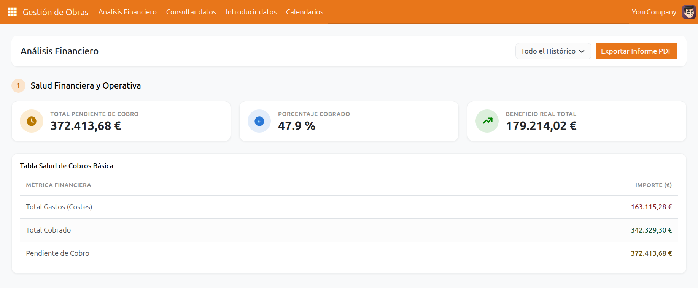 | 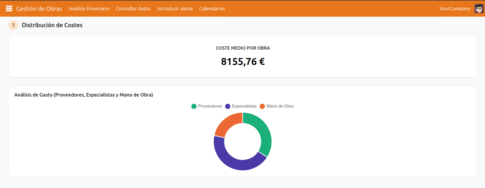 |
| *Análisis de salud financiera e indicadores clave de rendimiento* | *Desglose analítico de costes directos e indirectos* |

| Tesorería & Flujo de Caja | Evolución & Proyecciones |
| :---: | :---: |
| 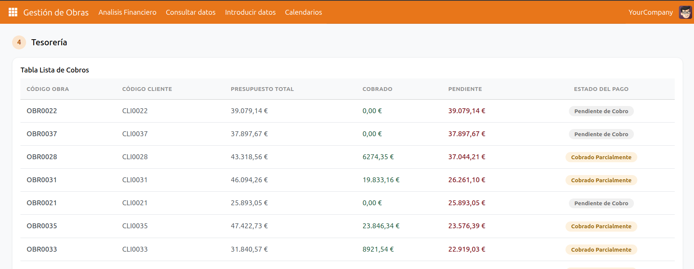 | 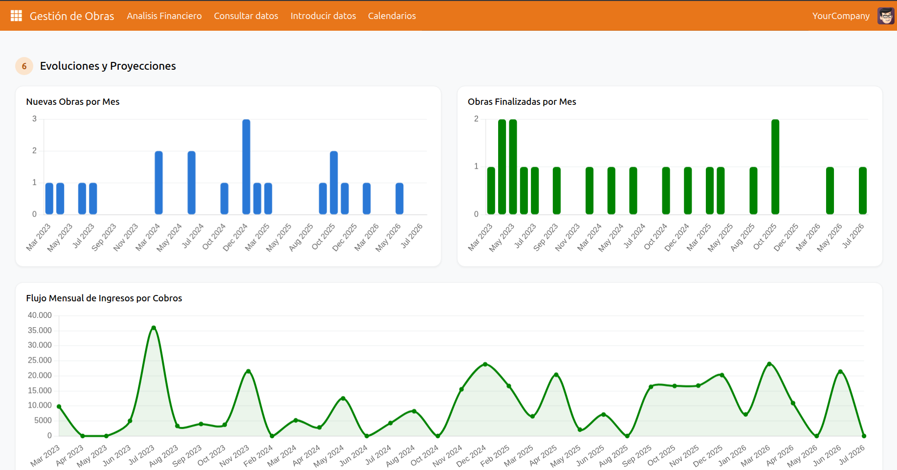 |
| *Control de liquidez, entradas y salidas en tiempo real* | *Previsiones presupuestarias e históricos de balance* |

---

#### 2. Vistas de Gestión y Modelos de Datos

| Vista Kanban (Gestión de Obras / Proyectos) | Vista Formulario (Gestión de Partes de Trabajo) |
| :---: | :---: |
|  | 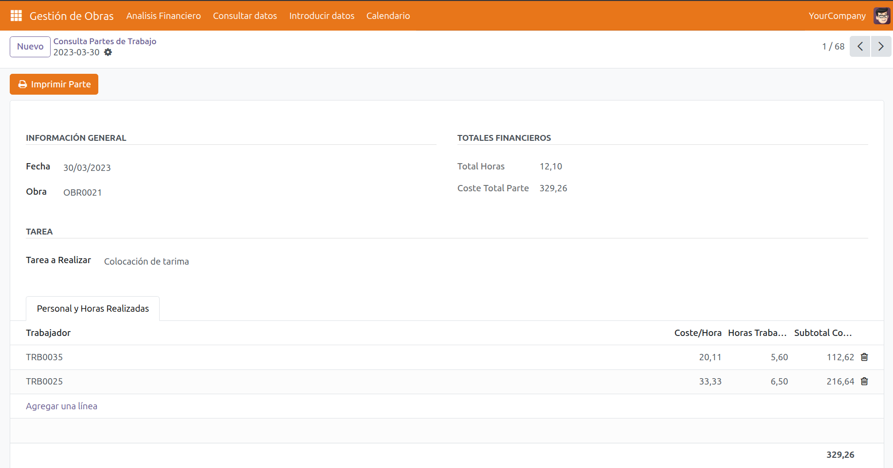 |
| *Flujo visual de estados y seguimiento analítico por etapa* | *Lógica relacional avanzada, validaciones y restricciones de negocio* |

**Esquema Relacional Completo (41 tablas)**

<a href="https://raw.githubusercontent.com/pdawgabriel-hub/pdawgabriel-hub/main/assets/esquema-relacional.png"></a>

*Diagrama entidad-relación completo generado a partir de los modelos Odoo. Haz clic en la imagen para abrirla a tamaño completo y ampliarla.*

---

#### 3. Documentos y Reportes Impresos (PDF/QWeb)

| Presupuesto de Obra | Informe de Estado de Obra | Parte de Trabajo Diario |
| :---: | :---: | :---: |
| 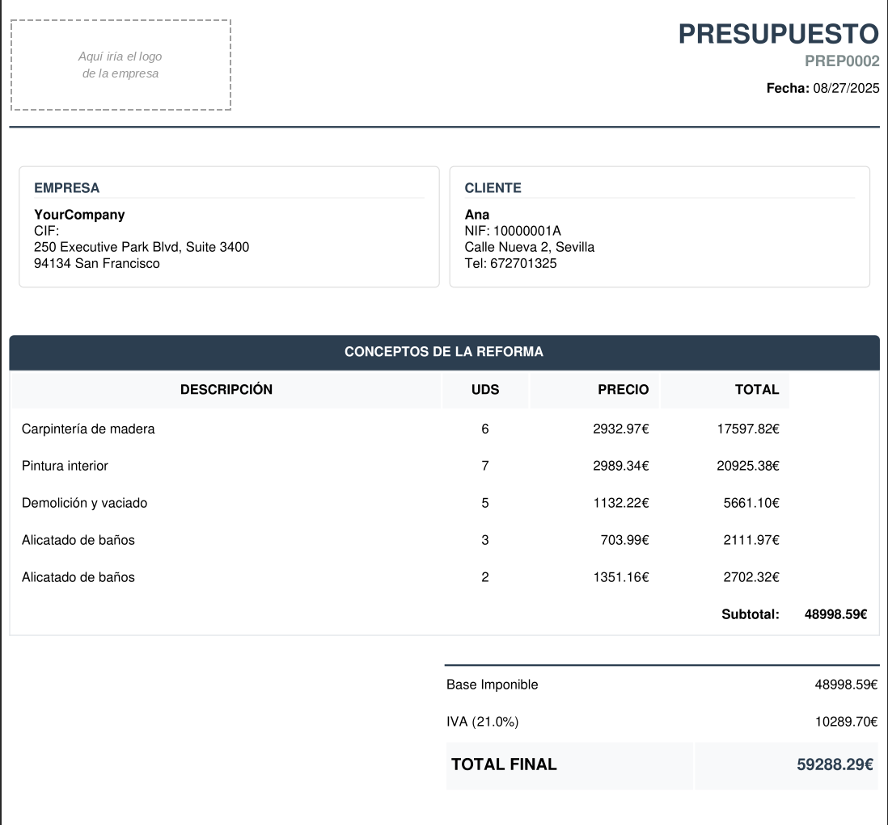 | 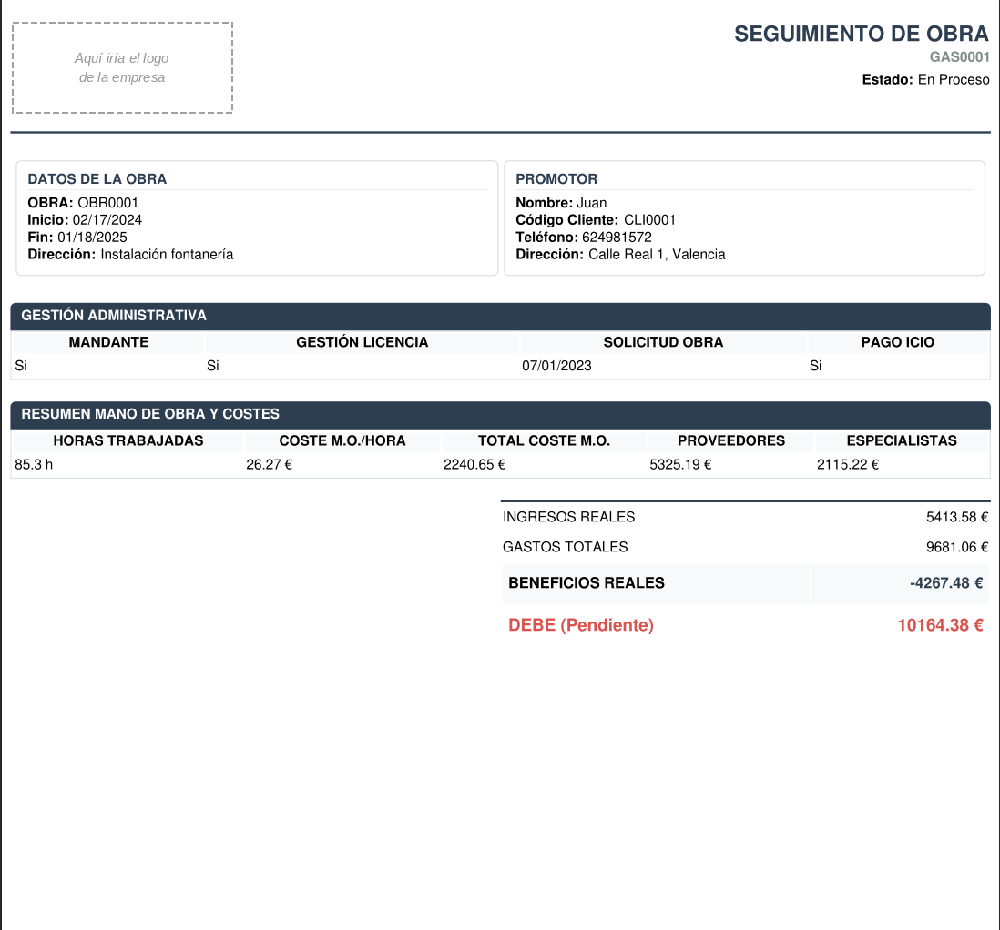 | 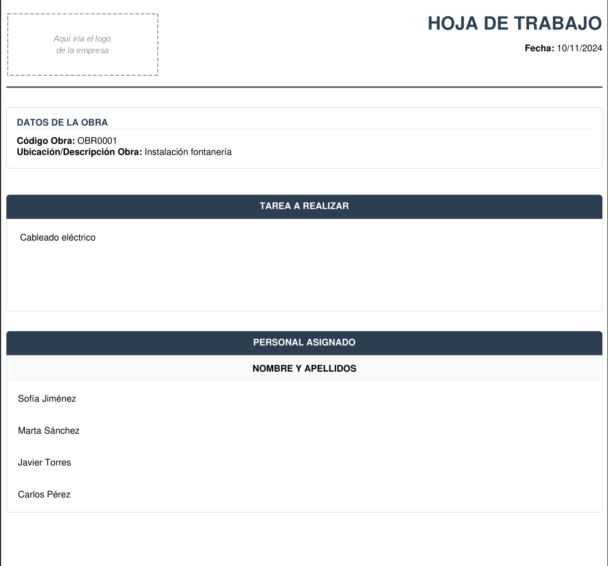 |
| *Presupuesto detallado para cliente con impuestos e imprevistos* | *Resumen ejecutivo de costes, avance y desviaciones* | *Control diario de mano de obra y materiales consumidos* |

</details>

<br>

<table align="center">
  <tr>
    <td>
      <a href="https://rock-and-roll-pizza.vercel.app/">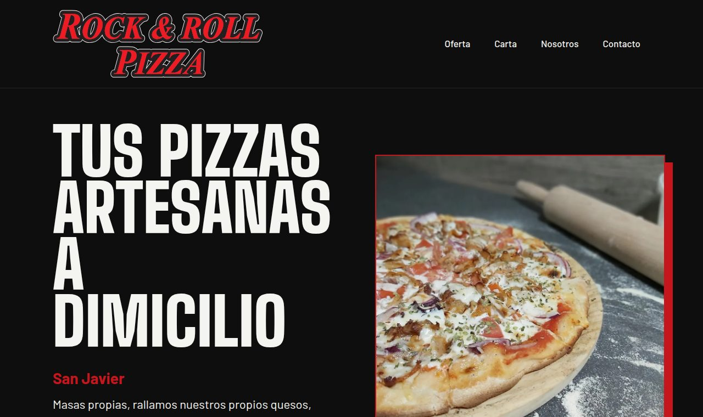</a>
      <h3>Rock & Roll Pizza</h3>
      
      <p>Web para una pizzería que sustituye su WordPress inicial: el cliente edita la oferta de la semana y los datos del negocio desde su propio panel, sin tocar código.</p>
      <p>
        
        
        
      </p>
      <a href="https://rock-and-roll-pizza.vercel.app/"></a>
      
    </td>
  </tr>
</table>

<details>
<summary><b>Ver detalles y estructura del proyecto</b></summary>

<br>

Proyecto real para una pizzería, con la que sustituyo un WordPress inicial por una web más ligera. Aún en fase de diseño y maquetación.

*   **Rock & Roll Pizza — Web para un cliente real (Astro & Sanity)**:
*   **Funciones:** portada, oferta de la semana editable por el cliente (con fecha de inicio y fin), carta (imágenes y PDF descargable), sección "Quiénes somos" y contacto con dirección, teléfono y horario.
*   **Gestión de contenido:** el cliente cambia la oferta y los datos del negocio desde un panel propio (Sanity Studio), con correo y contraseña, sin tocar código; la web se reconstruye sola al publicar.
*   **Estado:** en desarrollo, trabajando el diseño y el contenido antes de conectar el panel y pasar a producción. El repositorio es privado por tratarse de un proyecto de cliente.

```
rock-and-roll-pizza/
├── web/                  # Astro + Tailwind
│   ├── src/
│   │   ├── assets/       # logo, imágenes
│   │   ├── components/   # Header, Hero, Oferta, Carta, Nosotros, Contacto, Footer
│   │   ├── data/         # datos de ejemplo (site, oferta)
│   │   ├── layouts/
│   │   └── pages/
│   └── public/
└── studio/               # Sanity Studio (panel del cliente)
```

</details>

---

## Proyectos personales

<table align="center">
  <tr>
    <td>
      <a href="https://luzpreddict.vercel.app">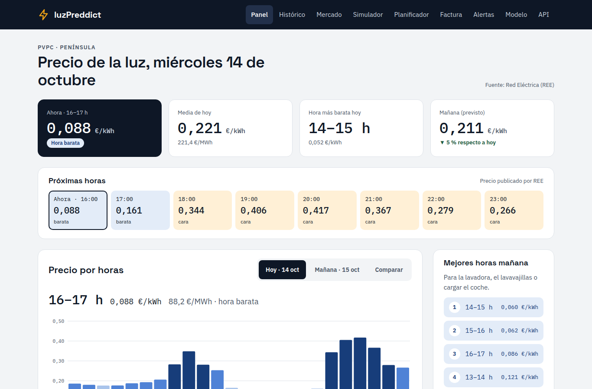</a>
      <h3>luzPreddict</h3>
      
      <p>Previsión hora a hora del precio de la luz (PVPC) del día siguiente con machine learning, con web y API públicas que ayudan a decidir cuándo consumir para pagar menos.</p>
      <p><sub><b>30 % menos de error que la mejor referencia · 822 tests</b></sub></p>
      <p>
        
        
        
        
        
      </p>
      <a href="https://luzpreddict.vercel.app"></a>
      <a href="https://luzpreddict.vercel.app/docs"></a>
      <a href="https://github.com/pdawgabriel-hub/luzPreddict"></a>
    </td>
  </tr>
  <tr>
    <td>
      <picture>
        <source media="(max-width: 767px)" srcset="https://raw.githubusercontent.com/pdawgabriel-hub/pdawgabriel-hub/main/assets/luzpreddict-flujo-movil.svg">
        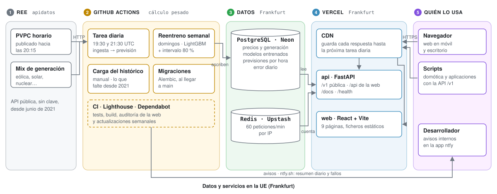
      </picture>
    </td>
  </tr>
</table>

<details>
<summary><b>Ver detalles técnicos</b></summary>

<br>

Web y API públicas que prevén, hora a hora, el precio de la luz del mercado regulado español (PVPC) del día siguiente con un modelo de machine learning, y ayudan a decidir cuándo consumir para pagar menos. Recorre el ciclo completo de un producto de datos — ingesta, modelo, base de datos, API, web, automatización y despliegue — y funciona en producción sin coste.

*   **luzPreddict - Previsión del Precio de la Luz (PVPC) con Machine Learning (Python, FastAPI & React)**
*   **Datos e ingesta:** PVPC horario y mix de generación de la API pública de Red Eléctrica desde junio de 2021 (unas 47.000 horas), con descarga incremental e idempotente y los días de 23 y 25 horas de los cambios de hora resueltos trabajando en UTC.
*   **Modelo:** LightGBM con 17 variables de calendario y de precios anteriores, evaluado día a día (*walk-forward*) con periodos de validación y de prueba separados: se equivoca un 30 % menos que la mejor referencia simple. Da además un rango probable por hora con regresión por cuantiles, calibrado para que el precio real caiga dentro 8 de cada 10 horas, y publica una referencia de respaldo si el modelo no se puede usar.
*   **API pública:** FastAPI de solo lectura y sin clave, documentada con OpenAPI, con errores uniformes, caché en la CDN hasta la siguiente actualización de los datos y límite de 60 peticiones por minuto e IP con Upstash Redis.
*   **Web:** React 19 y TypeScript con nueve secciones (panel, histórico, mercado, simulador de ahorro por aparato, planificador según la potencia contratada, comparador PVPC frente a precio fijo, alertas, evaluación del modelo y documentación de la API), gráficas SVG propias con tablas accesibles y accesibilidad 100 en Lighthouse.
*   **Automatización:** GitHub Actions para la tarea diaria (ingesta, previsión y error frente al precio real), el reentrenamiento semanal, las migraciones de PostgreSQL con Alembic y una auditoría Lighthouse tras cada despliegue, con avisos internos al móvil por ntfy y Dependabot semanal.
*   **Calidad:** 608 tests de Python contra un PostgreSQL real (incluido que el modelo nunca vea el día que predice) y 214 de la web con Vitest y cobertura mínima obligatoria; CI con ruff, oxlint y TypeScript en cada push.
*   **Arquitectura y despliegue:** el cálculo pesado en GitHub Actions y el servicio (web y API) en Vercel, con PostgreSQL en Neon, todo en planes gratuitos. Docker Compose para levantarlo en local y una [guía técnica](https://pdawgabriel-hub.github.io/luzPreddict/) publicada con MkDocs.

</details>

<details>
<summary><b>Ver capturas de la web</b></summary>

<br>

| Panel | Simulador | Modelo |
| :---: | :---: | :---: |
|  | 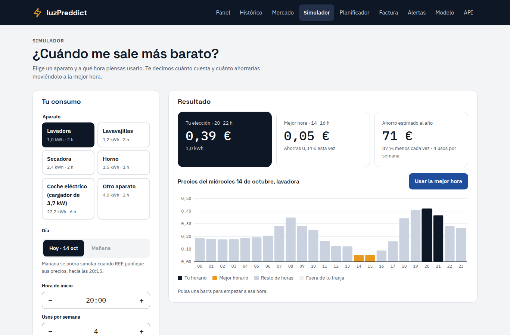 | 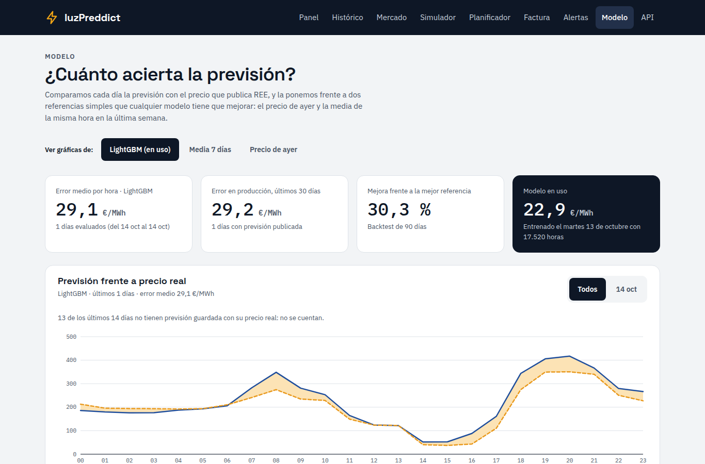 |
| *Precio de ahora, de hoy y previsión de mañana* | *Coste y ahorro moviendo un aparato de hora* | *Previsión frente a precio real y frente a las referencias* |

</details>

<br>

<table align="center">
  <tr>
    <td>
      <a href="https://pdawgabriel-hub.shinyapps.io/geoalquiler/"></a>
      <h3>GeoAlquiler</h3>
      <p>Observatorio del alquiler de los ~8.200 municipios de España con datos oficiales, junto a un análisis de mercado con machine learning y herramientas para inversores.</p>
      <p><sub><b>15 módulos Shiny · 29 tests · mapa nacional en ~1,2 s</b></sub></p>
      <p>
        
        
        
        
      </p>
      <a href="https://pdawgabriel-hub.shinyapps.io/geoalquiler/"></a>
      <a href="https://github.com/pdawgabriel-hub/geo-alquiler"></a>
    </td>
  </tr>
  <tr>
    <td>
      <picture>
        <source media="(max-width: 767px)" srcset="https://raw.githubusercontent.com/pdawgabriel-hub/pdawgabriel-hub/main/assets/geoalquiler-flujo-movil.svg">
        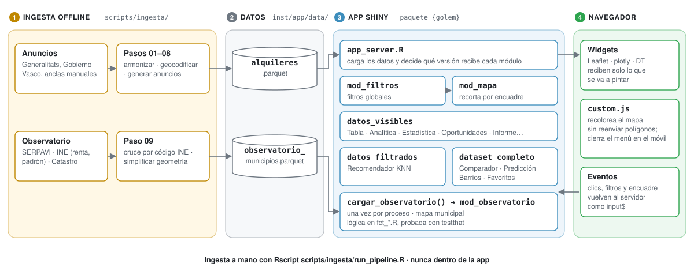
      </picture>
    </td>
  </tr>
</table>

<details>
<summary><b>Ver detalles técnicos</b></summary>

<br>

Aplicación web analítica construida como paquete de R (framework `{golem}`) con dos partes: análisis de un mercado de anuncios de alquiler en cinco ciudades, con Machine Learning y herramientas de inversión, y un **Observatorio del Alquiler** a escala nacional que cruza datos oficiales de los ~8.200 municipios de España. Todos los datos proceden de fuentes reales a través de un pipeline de ingesta propio.

*   **GeoAlquiler - Inteligencia Inmobiliaria y Observatorio del Alquiler en España (R & Shiny)**
*   **Observatorio del Alquiler en España:** mapa coroplético municipal que cruza el índice oficial de alquiler del Ministerio de Vivienda (SERPAVI) con la renta media de los hogares y el padrón del INE y el parque residencial del Catastro, todo del mismo año. 8 indicadores (alquiler €/m², esfuerzo del alquiler sobre la renta, peso del alquiler en el parque de viviendas, valor catastral, población…), ficha de cada municipio con su percentil nacional, gráfico renta vs. alquiler y ranking, sincronizados entre sí.
*   **Datos e ingesta:** precios por zona de fuentes autonómicas (Generalitat de Catalunya, Generalitat Valenciana y Gobierno Vasco), con anclas documentadas a mano donde no existe fuente oficial. Para el Observatorio: la capa municipal de SERPAVI, la tabla nacional de renta del INE (~350 MB) filtrada en streaming y las estadísticas del Catastro por provincia, extraídas reproduciendo su formulario web. El Catastro no publica el código INE, así que los municipios se cruzan por nombre (normalizado, aproximado y con equivalencias para municipios renombrados) hasta cubrir todos sus registros.
*   **Analítica & ML:** modelo predictivo de precios por regresión, recomendador de inmuebles similares con K-Nearest Neighbors (KNN), detector automático de oportunidades de inversión, calculadora de rentabilidad con amortización hipotecaria y proyección de cash flow, e informe ejecutivo descargable.
*   **Arquitectura:** 15 módulos Shiny independientes (`NS(id)` + `*UI()`/`*Server()`) con la lógica de negocio separada en funciones puras sin dependencias de Shiny, que comparten el pipeline y la app. Documentada con esquema de arquitectura y una [guía técnica](https://github.com/pdawgabriel-hub/geo-alquiler/blob/main/docs/GUIA_TECNICA.md) con recorrido por el código.
*   **Rendimiento:** mapas agregados en servidor, `plotly` nativo con histogramas pre-agregados y submuestreo en gráficos densos. El Observatorio pinta ~8.200 polígonos con geometría en dos niveles de detalle, un serializador JSON vectorizado propio (de ~6 s a ~1,4 s) y recoloreo en el navegador con JavaScript al cambiar de indicador: el mapa nacional aparece en ~1,2 s, frente a los ~3,2 s iniciales.
*   **Calidad:** 29 tests con 102 comprobaciones (`testthat` y `testServer()` para los módulos) sobre los cálculos financieros, los indicadores y el cruce de fuentes; integración continua con GitHub Actions que instala desde cero las versiones exactas de `{renv}` y ejecuta los tests en cada push.

</details>

<br>

<table align="center">
  <tr>
    <td>
      <a href="https://dashboard-financiero-kappa-blue.vercel.app/"></a>
      <h3>ERP Construcción - Dashboard Financiero</h3>
      <p>Versión 100% frontend del ERP de construcción: 13 entidades, dashboard financiero, formularios validados y exportación a PDF.</p>
      <p>
        
        
        
        
      </p>
      <a href="https://dashboard-financiero-kappa-blue.vercel.app/"></a>
      <a href="https://github.com/pdawgabriel-hub/dashboard-financiero"></a>
    </td>
  </tr>
  <tr>
    <td>
      <picture>
        <source media="(max-width: 767px)" srcset="https://raw.githubusercontent.com/pdawgabriel-hub/pdawgabriel-hub/main/assets/dashboard-flujo-movil.svg">
        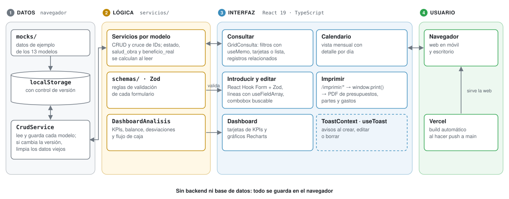
      </picture>
    </td>
  </tr>
</table>

<details>
<summary><b>Ver detalles técnicos</b></summary>

<br>

Ecosistema frontend modular e inteligente para el análisis contable y control presupuestario de obras en tiempo real, adaptando a una versión 100% frontend (sin backend ni base de datos física, persistencia en `localStorage` versionado) el modelo de negocio de 13 entidades del ERP a medida hecho sobre Odoo.

*   **ERP Construcción - Dashboard Financiero (React & TypeScript)**
*   **Características:** Vistas intercambiables de tarjetas/lista con tarjetas totalmente clicables, registros relacionados tipo "smart button" en cada ficha (Cliente, Obra, Trabajador...), calendario mensual tipo Google Calendar, autocompletado con combobox buscable en los selectores de relación, y filtrado predictivo relacional optimizado con `useMemo` (inmune a discrepancias de texto).
*   **Formularios y Documentos:** Automatización interactiva de importes netos/IVA mediante React Hook Form y Zod, y exportación a PDF (Presupuestos, Partes de Trabajo, seguimiento de Gastos) vía páginas de impresión dedicadas y `window.print()`.
*   **Visualización:** Gráficos de balance e históricos con Recharts y sistema global de notificaciones reactivas a través de un contexto personalizado manejado por el hook `useToast`.

</details>

---

## Próximamente

**Migración del ERP de Construcción a SAP ABAP / HANA** · *en planificación*

<details>
<summary><b>Ver en qué consiste</b></summary>

<br>

Llevar el ERP de gestión de obras (hoy en Odoo 18) a SAP S/4HANA, reimplementando el mismo modelo de datos y la misma lógica de negocio — presupuestos, obras, partes de trabajo/especialista/proveedor y seguimiento financiero — en ABAP sobre HANA, apoyándose en la documentación técnica ya generada del proyecto original (esquema relacional, modelos y métodos) como base de la migración.

</details>

---

## Tecnologías y Herramientas

**Lenguajes**<br>
    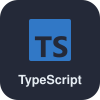 

**Frontend & UI**<br>
  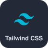 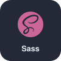 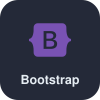  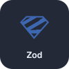

**Backend, ERP & Frameworks**<br>
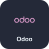  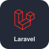 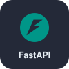

**Ciencia de Datos & Machine Learning**<br>
    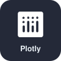 

**Bases de Datos, DevOps & Sistemas**<br>
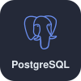  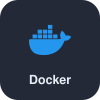    

---

<p align="center">
  <a href="mailto:pdawgabriel@gmail.com">pdawgabriel@gmail.com</a>
</p>
